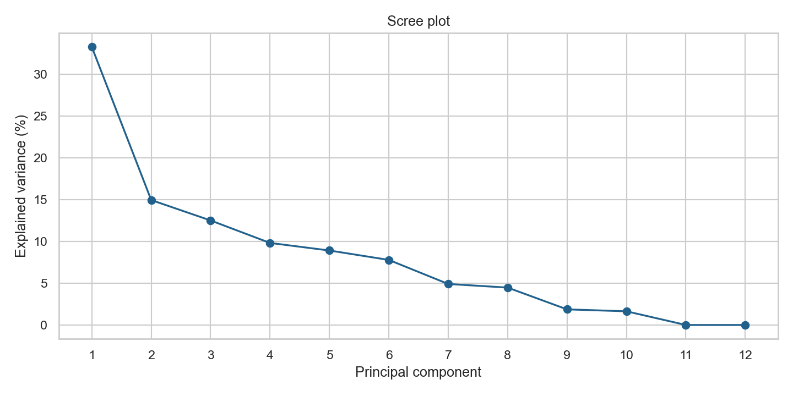
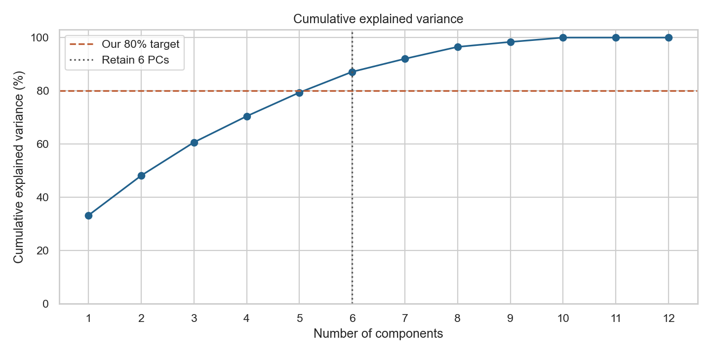
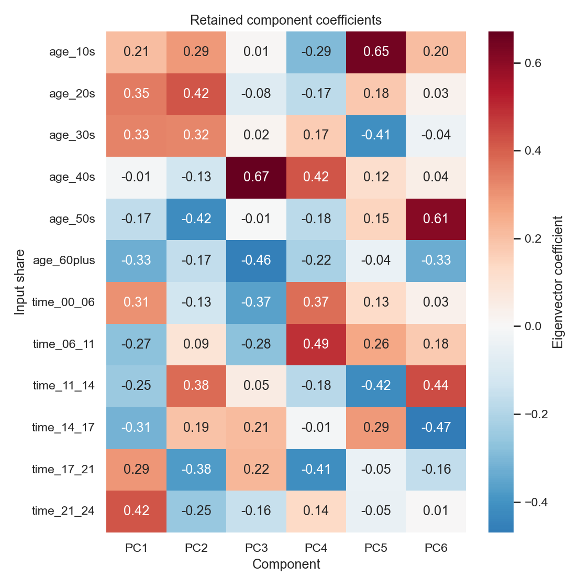
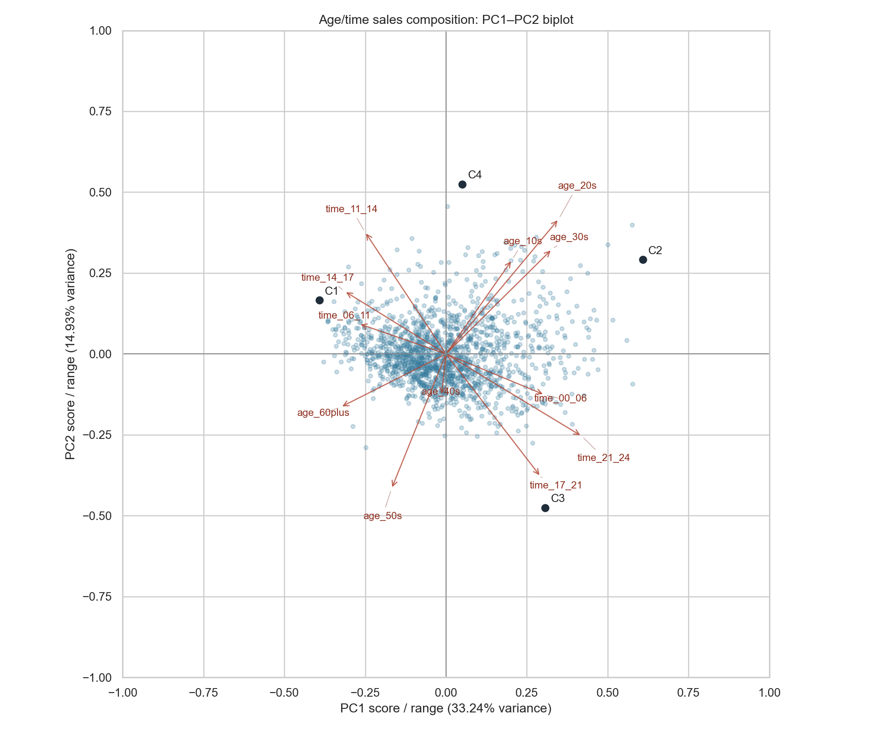

# Seoul Commercial District Sales Patterns: Session 2

**Hyunsoo Lee and Taejoon Ha · CDS 303 · Final Project 2**

[Executed notebook](./CDS303_Project2.ipynb) · [Data and run instructions](../../data/README.md) · [Session 1](../session-1/index.md)

## 1. Refined Research Question, Audience, and Potential Use

**Research question.** What are the main dimensions of variation in the age-group and time-of-day sales shares of Seoul commercial districts in 2025, and how can these differences be compared alongside store composition when screening candidate locations?

Our audience is **prospective business owners in Seoul and small-business startup counselors**. Owners need to compare which age bands account for sales, when sales occur, and the establishments already reported at candidate locations. Counselors need a clear way to organize these comparisons without treating total sales as a complete measure of opportunity. The PCA can help structure comparisons and operating-hour hypotheses; integrated store information adds scale and franchise context for deciding where to conduct fieldwork. We do not estimate customer headcounts, profitability, or startup success.

We keep Session 1's district-level age/time design. This stage completes integration and PCA; clustering and classification will follow later.

## 2. Data Sources and Integration

Both files are from the **Seoul Credit Guarantee Foundation through Seoul Open Data Plaza**. We reused our existing 2025 sales ZIP and obtained the official 2025 store ZIP on November 22, 2026. The notebook reads the included source CSV data directly from ZIP files, using CP949 encoding. The sales CSV bytes are unchanged; its ZIP was recompressed as documented in the data instructions. Each raw row is one commercial district × service industry × quarter.

| Source   |   Rows |   Columns |   Districts |   Industries |   Missing cells |   Duplicate keys |
|:---------|-------:|----------:|------------:|-------------:|----------------:|-----------------:|
| Sales    |  85732 |        55 |        1577 |           62 |               0 |                0 |
| Stores   | 304775 |        14 |        1650 |          100 |               0 |                0 |

The quarter-level audit confirms the periods and reporting coverage:

|   기준_년분기_코드 |   Sales rows |   Sales districts |   Sales industries |   Store rows |   Store districts |   Store industries |
|-------------------:|-------------:|------------------:|-------------------:|-------------:|------------------:|-------------------:|
|              20251 |        21427 |              1572 |                 62 |        76383 |              1650 |                100 |
|              20252 |        21452 |              1570 |                 62 |        76238 |              1650 |                100 |
|              20253 |        21520 |              1569 |                 62 |        76169 |              1650 |                100 |
|              20254 |        21333 |              1565 |                 62 |        75985 |              1650 |                100 |

The actual store CSV uses English headers. The verified mapping is:

| Store field | Meaning / corresponding sales field |
| --- | --- |
| `stdr_yyqu_cd` | `기준_년분기_코드` |
| `trdar_cd` | `상권_코드` |
| `svc_induty_cd` | `서비스_업종_코드` |
| `similr_induty_stor_co` | Total stores |
| `stor_co` | General stores |
| `frc_stor_co` | Franchise stores |

All rows satisfy total stores = general stores + franchise stores. We found no blank cells or duplicate three-field keys in either source. Both files cover 20251–20254. All 85,732 sales keys match store keys; 219,043 store keys have no sales row. District names/types and industry labels agree on matching keys. District names/types are also stable over quarters and agree for shared district codes. No all-industry total category is included in the store category list, so its 100 distinct categories can be summed without adding a separate total row.

**Space and time.** Both sources describe commercial districts, with the same provider notice about spatial units. We align the same 2025 quarter codes and check district IDs, types and names. We do not merge administrative-district or catchment-area records. Code/name checks do not independently verify boundaries; no old boundary geometry is used in this stage. Commercial districts can overlap, so we do not interpret their sum as a deduplicated Seoul total.

**Aggregation.** We sum the reported sales amounts over quarters and industries within each district before calculating percentages. For stores, we sum all reported industries within each district-quarter, then average those quarterly totals. Average total stores can therefore be fractional. Franchise share is 100 × the sum of quarterly franchise counts / the sum of quarterly total counts over the same observed quarters, equivalent to the ratio of their quarterly means. It is not the unweighted mean of quarterly percentages. We do not add quarterly stocks and call the result unique annual stores. Opening/closure rates are not used.

We aggregate stores independently to preserve the 38 store categories not present in sales. We then left-join the district summaries on the district code with `validate='one_to_one'` and an indicator. **A final row represents one district's 2025 reported-sales profile and its average quarterly store context.**

| Measure                       |   Value |
|:------------------------------|--------:|
| Sales districts before merge  | 1577.00 |
| Store districts before merge  | 1650.00 |
| Rows after left merge         | 1577.00 |
| Unique districts after merge  | 1577.00 |
| Matched sales districts       | 1577.00 |
| Unmatched sales districts     |    0.00 |
| Store-only districts          |   73.00 |
| Sales district match rate (%) |  100.00 |

There is no row multiplication. All 1,577 sales districts have four store quarters. We retain all 1,577 in the integrated table, including the 17 with incomplete sales-year coverage. The 73 store-only districts remain outside the sales-led analysis. An absent row is not replaced by zero.

## 3. Variables and Preprocessing

**PCA inputs:** `age_10s`, `age_20s`, `age_30s`, `age_40s`, `age_50s`, `age_60plus`, `time_00_06`, `time_06_11`, `time_11_14`, `time_14_17`, `time_17_21`, `time_21_24`.

Each age share is 100 × its aggregated age amount / the sum of the six age amounts. Each time share is 100 × its aggregated time amount / aggregated total sales. These formulas produce more than three substantive derived variables while preserving the original research purpose.

Age amounts differ from total sales in **50,298** raw rows; one row has zero age-attributed sales. The provider explains that total sales can include corporate purchases without age information. Time amounts and weekday/weekend amounts reconcile to total sales in every raw row. All district-level age and total denominators are positive. No raw or derived PCA missing value is imputed, and observed zeros remain valid values.

| Status                |   Districts |
|:----------------------|------------:|
| Included              |        1560 |
| Incomplete sales year |          17 |

The final PCA uses **1,560 districts and 12 inputs**. The other districts have nine two-quarter, five three-quarter, and three one-quarter sales profiles. No additional district is removed for invalid shares, store matching, outliers or a volume cutoff. All 12 features have nonzero variance and finite values. The [feature audit](./results/feature_summary.csv) reports mean, standard deviation, range, missingness and observed zeros.

Among included districts, **1,126** have at least one reported industry missing in some quarters. Across all sales districts, **2,649** observed district–industry pairs have fewer than four quarters. A complete district year therefore does not ensure a fixed industry panel. We aggregate what is reported, do not treat absent categories as zero, and flag industry coverage in the case table. The median age-attribution coverage is **93.97%**, but the minimum is **11.82%**. The smallest annual transaction total is **210**. These observations remain in the analysis, with limitations rather than unsupported deletion rules.

| Variable                           | Formula / source                                                        | Unit            | Role       | Reason / preparation                                            | Missing / preprocessing                                                                                          |
|:-----------------------------------|:------------------------------------------------------------------------|:----------------|:-----------|:----------------------------------------------------------------|:-----------------------------------------------------------------------------------------------------------------|
| age_10s                            | 100 × sum(연령대_10_매출_금액) / sum of six aggregated age amounts      | %               | PCA input  | Age/time composition; positive denominator, then StandardScaler | No missing after annual aggregation; undefined denominator stays missing; invalid profile excluded; standardized |
| age_20s                            | 100 × sum(연령대_20_매출_금액) / sum of six aggregated age amounts      | %               | PCA input  | Age/time composition; positive denominator, then StandardScaler | No missing after annual aggregation; undefined denominator stays missing; invalid profile excluded; standardized |
| age_30s                            | 100 × sum(연령대_30_매출_금액) / sum of six aggregated age amounts      | %               | PCA input  | Age/time composition; positive denominator, then StandardScaler | No missing after annual aggregation; undefined denominator stays missing; invalid profile excluded; standardized |
| age_40s                            | 100 × sum(연령대_40_매출_금액) / sum of six aggregated age amounts      | %               | PCA input  | Age/time composition; positive denominator, then StandardScaler | No missing after annual aggregation; undefined denominator stays missing; invalid profile excluded; standardized |
| age_50s                            | 100 × sum(연령대_50_매출_금액) / sum of six aggregated age amounts      | %               | PCA input  | Age/time composition; positive denominator, then StandardScaler | No missing after annual aggregation; undefined denominator stays missing; invalid profile excluded; standardized |
| age_60plus                         | 100 × sum(연령대_60_이상_매출_금액) / sum of six aggregated age amounts | %               | PCA input  | Age/time composition; positive denominator, then StandardScaler | No missing after annual aggregation; undefined denominator stays missing; invalid profile excluded; standardized |
| time_00_06                         | 100 × sum(시간대_00~06_매출_금액) / sum(당월_매출_금액)                 | %               | PCA input  | Age/time composition; positive denominator, then StandardScaler | No missing after annual aggregation; undefined denominator stays missing; invalid profile excluded; standardized |
| time_06_11                         | 100 × sum(시간대_06~11_매출_금액) / sum(당월_매출_금액)                 | %               | PCA input  | Age/time composition; positive denominator, then StandardScaler | No missing after annual aggregation; undefined denominator stays missing; invalid profile excluded; standardized |
| time_11_14                         | 100 × sum(시간대_11~14_매출_금액) / sum(당월_매출_금액)                 | %               | PCA input  | Age/time composition; positive denominator, then StandardScaler | No missing after annual aggregation; undefined denominator stays missing; invalid profile excluded; standardized |
| time_14_17                         | 100 × sum(시간대_14~17_매출_금액) / sum(당월_매출_금액)                 | %               | PCA input  | Age/time composition; positive denominator, then StandardScaler | No missing after annual aggregation; undefined denominator stays missing; invalid profile excluded; standardized |
| time_17_21                         | 100 × sum(시간대_17~21_매출_금액) / sum(당월_매출_금액)                 | %               | PCA input  | Age/time composition; positive denominator, then StandardScaler | No missing after annual aggregation; undefined denominator stays missing; invalid profile excluded; standardized |
| time_21_24                         | 100 × sum(시간대_21~24_매출_금액) / sum(당월_매출_금액)                 | %               | PCA input  | Age/time composition; positive denominator, then StandardScaler | No missing after annual aggregation; undefined denominator stays missing; invalid profile excluded; standardized |
| age_coverage                       | 100 × sum(age amounts) / total sales                                    | %               | Context    | Age attribution quality                                         | Missing match/zero denominator stays missing; no imputation; not standardized for PCA                            |
| weekend_share                      | 100 × weekend / (weekday + weekend)                                     | %               | Context    | Trading-day context                                             | Missing match/zero denominator stays missing; no imputation; not standardized for PCA                            |
| 당월_매출_금액                     | sum of reported quarterly industry sales                                | KRW             | Context    | Scale; excluded from PCA                                        | No missing; retained as context without imputation or PCA scaling                                                |
| sales_per_transaction              | sales / transactions                                                    | KRW/transaction | Context    | Positive transaction denominator                                | Missing match/zero denominator stays missing; no imputation; not standardized for PCA                            |
| mean_total_stores                  | mean of quarterly sums of similr_induty_stor_co                         | stores          | Context    | All 100 store categories; unmatched stays missing               | Missing match/zero denominator stays missing; no imputation; not standardized for PCA                            |
| franchise_share                    | 100 × mean franchise stores / mean total stores                         | %               | Context    | Same quarters/categories; positive denominator                  | Missing match/zero denominator stays missing; no imputation; not standardized for PCA                            |
| 상권_코드, 상권_코드_명            | district code/name                                                      | identifier      | Identifier | Join/display only                                               | No missing; code kept as text for linkage/display only                                                           |
| 기준_년분기_코드, 서비스_업종_코드 | quarter/category codes                                                  | identifier      | Excluded   | Grouping/linkage only                                           | Not a PCA input; no imputation or encoding                                                                       |
| 상권_구분_코드                     | official district type                                                  | categorical     | Context    | No encoding or PCA input                                        | No missing; retained as context without imputation or PCA scaling                                                |
| Other raw amount/count breakdowns  | original source columns                                                 | KRW/count       | Excluded   | Redundant breakdowns or outside age/time question               | Not a PCA input; no imputation or encoding                                                                       |

We use **StandardScaler** as in Demo 6: subtract each feature's mean and divide by its population standard deviation. Equal percentage units do not imply equal variability. Standardization gives each input equal initial variance, though it can amplify low-spread variables. Each district is equally weighted. Categorical variables are not encoded or included. Scale, weekend and store measures remain contextual so the baseline PCA describes composition.

Each age/time block sums to 100%, giving two linear dependencies. The standardized matrix rank is **10**. We retain all 12 interpretable shares as planned and recognize the resulting near-zero components and dependence among shares. This is descriptive PCA of percentages, not a compositional log-ratio model.

## 4. PCA Results and Component Selection

We follow Demo 6's `StandardScaler`, `PCA`, explained-variance, coefficient, score and biplot workflow. We use `PCA(n_components=None, svd_solver='full', random_state=2000)` for deterministic full SVD. Integration checks, component selection and exports are additions for this project.

| Component   |   Eigenvalue |   Explained variance (%) |   Cumulative variance (%) |
|:------------|-------------:|-------------------------:|--------------------------:|
| PC1         |       3.9908 |                  33.2355 |                   33.2355 |
| PC2         |       1.7929 |                  14.9316 |                   48.1670 |
| PC3         |       1.5000 |                  12.4916 |                   60.6586 |
| PC4         |       1.1773 |                   9.8047 |                   70.4633 |
| PC5         |       1.0686 |                   8.8996 |                   79.3630 |
| PC6         |       0.9335 |                   7.7741 |                   87.1370 |
| PC7         |       0.5883 |                   4.8991 |                   92.0361 |
| PC8         |       0.5365 |                   4.4679 |                   96.5040 |
| PC9         |       0.2238 |                   1.8640 |                   98.3679 |
| PC10        |       0.1960 |                   1.6321 |                  100.0000 |
| PC11        |       0.0000 |                   0.0000 |                  100.0000 |
| PC12        |       0.0000 |                   0.0000 |                  100.0000 |

We retain **six components**, explaining **87.14%** of standardized variation. Five explain 79.36%, just below our chosen 80% compression target; PC6 adds 7.77 percentage points and captures an interpretable age-50s/lunch versus afternoon contrast. The scree plot has a large first drop but no uniquely decisive elbow through the middle components. There is a smaller contribution after PC6 (PC7: 4.90%), which supports six as a practical compromise. The 80% target is our analytical choice, not an instructor requirement or a claim that six is uniquely optimal. We retain the six score columns for the later project stage, without fitting any clusters now.

PC1 and PC2 together explain **48.17%**. The two-dimensional biplot is therefore a partial view, not the full retained representation. PC11 and PC12 are effectively zero because of the two share-sum constraints; the standardized matrix rank is 10.

## 5. Component Interpretation and Biplot

The table below uses **eigenvector coefficients** `pca.components_.T`, as in Demo 6. For standardized input vector z, the PC-k score is the sum of z-j × coefficient-jk. These coefficients are not variable–component correlations. We compare coefficient magnitudes within a component and read both signs together. Signs can reverse without changing the solution, so names below describe relative contrasts rather than fixed positive/negative labels.

| Variable   |    PC1 |    PC2 |    PC3 |    PC4 |    PC5 |    PC6 |
|:-----------|-------:|-------:|-------:|-------:|-------:|-------:|
| age_10s    |  0.205 |  0.292 |  0.009 | -0.293 |  0.645 |  0.204 |
| age_20s    |  0.349 |  0.418 | -0.085 | -0.175 |  0.185 |  0.032 |
| age_30s    |  0.328 |  0.324 |  0.016 |  0.171 | -0.410 | -0.036 |
| age_40s    | -0.014 | -0.131 |  0.671 |  0.421 |  0.117 |  0.044 |
| age_50s    | -0.169 | -0.418 | -0.006 | -0.179 |  0.146 |  0.612 |
| age_60plus | -0.327 | -0.165 | -0.457 | -0.217 | -0.044 | -0.329 |
| time_00_06 |  0.306 | -0.127 | -0.366 |  0.374 |  0.129 |  0.034 |
| time_06_11 | -0.271 |  0.094 | -0.276 |  0.485 |  0.258 |  0.175 |
| time_11_14 | -0.251 |  0.378 |  0.053 | -0.185 | -0.417 |  0.439 |
| time_14_17 | -0.315 |  0.195 |  0.213 | -0.014 |  0.288 | -0.470 |
| time_17_21 |  0.293 | -0.380 |  0.223 | -0.413 | -0.046 | -0.163 |
| time_21_24 |  0.421 | -0.255 | -0.158 |  0.136 | -0.049 |  0.006 |

- **PC1 (33.24%): younger-age and later-sales orientation versus older-age and daytime orientation.** The largest coefficients are 21–24 (+0.421), age 20s (+0.349), age 30s (+0.328), and age 60+ (−0.327). Afternoon 14–17 is also negative (−0.315). High scores combine these standardized features; they do not prove that younger buyers made the late purchases.
- **PC2 (14.93%): younger-age/lunch orientation versus age-50s/evening orientation.** Age 20s (+0.418) and 11–14 (+0.378) contrast with age 50s (−0.418) and 17–21 (−0.380). Age 30s is also positive (+0.324). Individual districts can reach a high score through different combinations.
- **PC3 (12.49%): age-40s contrast.** Age 40s (+0.671) contrasts most strongly with age 60+ (−0.457) and 00–06 (−0.366).
- **PC4 (9.80%): morning/overnight and age-40s contrast with evening.** 06–11 (+0.485), age 40s (+0.421), and 00–06 (+0.374) contrast with 17–21 (−0.413). This mixes age and time differences rather than naming a single business type.
- **PC5 (8.90%): teen-share and afternoon contrast.** Age 10s (+0.645) and 14–17 (+0.288) contrast with 11–14 (−0.417) and age 30s (−0.410).
- **PC6 (7.77%): age-50s/lunch contrast with afternoon and age-60+.** Age 50s (+0.612) and 11–14 (+0.439) contrast with 14–17 (−0.470) and age 60+ (−0.329).

**Biplot scaling.** Following Demo 6, score coordinates are divided separately by each component's observed range. Arrow coordinates are the unscaled PC1/PC2 eigenvector coefficients. Equal plotted axis units do not undo those two different score scales. The display supports sign/direction comparisons, not exact variable-correlation angles, variance percentages from arrow lengths, or original score-space distances.

The biplot shows a dense central cloud with districts extending along several directions. Later-sales arrows point toward positive PC1, while daytime and age-60+ arrows point toward negative PC1. Lunch and age-20s arrows have positive PC2 coefficients, while age-50s and evening arrows have negative PC2 coefficients. These directions summarize continuous differences; no visual group is treated as a confirmed cluster.

The four labelled cases are the minimum and maximum scores on PC1 and PC2, with code order resolving ties. They were selected to make the dimensions concrete, not to represent typical districts or recommend sites.

- **C1, 남서울상가:** age-60+ sales account for 89.85% of age-attributed sales, and 11–17 accounts for 88.79% of sales. The store context is 19.00 average quarterly stores and 0.00% franchise share. However, the sales profile contains only one reported industry and 1,130 annual transactions. This is a thin reported-sales profile and needs a coverage check before use in location screening.
- **C2, 한양대앞상점가(한양시장, 왕십리맛골목):** age-20s share is 50.20% and 21–24 share is 25.74%. It has 234.50 average quarterly stores and 20.58% franchise share. This provides a contrasting location for investigating younger-age and later-sales patterns. It does not establish which ages bought at night or imply attractive profitability.
- **C3, 청림동주민센터(상도중학교):** age-50s share is 54.82% and 21–24 share is 55.84%; the district has 56.75 average quarterly stores and 2.20% franchise share. Its sales cover only one reported industry and 1,991 transactions, so the extreme composition may reflect narrow source coverage rather than the full local economy.
- **C4, 인수중학교:** age-30s share is 90.05% and 11–14 share is 49.46%, with 48.00 average quarterly stores and 9.90% franchise share. Its high PC2 score illustrates that a component is a weighted combination: not every high-PC2 district has a high age-20s share.

The integrated store measures help an owner distinguish an apparently similar sales orientation from the scale and franchise composition of reported establishments. A counselor can use the PCA directions to organize comparisons, then inspect each candidate's original percentages, industry coverage, transactions and store context. These examples are not a shortlist of recommended investments. All-store measures span 100 categories while sales cover 62; they are not same-sector competition measures. Before a sector-specific decision, the owner would need that sector's sales and stores, rent, costs and field observations.

**Case identities and source coverage**

| Case   |   상권_코드 | 상권_코드_명                           | Selected end   |   당월_매출_건수 |   sales_categories |   incomplete_industries |
|:-------|------------:|:---------------------------------------|:---------------|-----------------:|-------------------:|------------------------:|
| C1     |     3130254 | 남서울상가                             | PC1 low        |             1130 |                  1 |                       0 |
| C2     |     3130069 | 한양대앞상점가(한양시장, 왕십리맛골목) | PC1 high       |          3815873 |                 15 |                       1 |
| C3     |     3110898 | 청림동주민센터(상도중학교)             | PC2 low        |             1991 |                  1 |                       0 |
| C4     |     3110340 | 인수중학교                             | PC2 high       |             5914 |                  4 |                       1 |

**Age shares (% of age-attributed sales)**

| Case   |   age_10s |   age_20s |   age_30s |   age_40s |   age_50s |   age_60plus |
|:-------|----------:|----------:|----------:|----------:|----------:|-------------:|
| C1     |      0.00 |      0.00 |      0.00 |      7.76 |      2.38 |        89.85 |
| C2     |      6.23 |     50.20 |     21.59 |      8.31 |     10.50 |         3.17 |
| C3     |      0.00 |      2.17 |      5.68 |     17.28 |     54.82 |        20.05 |
| C4     |      0.01 |      0.13 |     90.05 |      5.86 |      1.56 |         2.40 |

**Time shares (% of total sales)**

| Case   |   time_00_06 |   time_06_11 |   time_11_14 |   time_14_17 |   time_17_21 |   time_21_24 |
|:-------|-------------:|-------------:|-------------:|-------------:|-------------:|-------------:|
| C1     |         0.00 |         5.99 |        44.76 |        44.02 |         5.23 |         0.00 |
| C2     |        12.97 |         2.27 |        12.59 |        10.12 |        36.30 |        25.74 |
| C3     |        16.48 |         0.00 |         0.34 |         5.14 |        22.20 |        55.84 |
| C4     |         0.03 |         7.91 |        49.46 |        38.67 |         3.36 |         0.57 |

**Integrated store context and scores**

| Case   |   age_coverage |   mean_total_stores |   franchise_share |   PC1 |   PC2 |
|:-------|---------------:|--------------------:|------------------:|------:|------:|
| C1     |         100.00 |               19.00 |              0.00 | -4.95 |  2.20 |
| C2     |          91.83 |              234.50 |             20.58 |  7.69 |  3.86 |
| C3     |          92.35 |               56.75 |              2.20 |  3.88 | -6.29 |
| C4     |          98.34 |               48.00 |              9.90 |  0.64 |  6.94 |

## 6. Implications and Limitations

The strongest dimension combines a younger-age and later-sales orientation against an older-age/daytime orientation; other retained components preserve additional age and time contrasts. Store context makes those comparisons more useful by showing how many establishments and what franchise share are reported for each example. Owners and counselors can inspect these patterns before deciding which locations deserve closer, sector-specific investigation.

- Age sales shares are not customer-count shares. Low attribution can make the known-age profile incomplete.
- Age and time are separate marginal distributions. We cannot identify the age profile of lunch or night buyers.
- Time windows have different lengths. Sales share is not sales per hour.
- Changing industry coverage and industry mix affect the aggregate district profile. Thin extreme cases require particular care.
- All-store counts cover more industries than estimated sales and are context, not a direct same-sector competition measure. Store counts do not establish unmet demand or profitability.
- Annual aggregation hides seasonal and quarterly shifts. Some commercial district areas can overlap.
- The first two PCs display 48.17%, while six retain 87.14%. The plot is a projection, not evidence of clusters or causal effects.

## 7. Reproducibility and References

The [notebook](./CDS303_Project2.ipynb) includes saved outputs and checks. The [data instructions](../../data/README.md) document both original ZIPs, hashes, field mappings, processed files and relative paths. Full schemas, loadings, variance, cases and scaler parameters are in [results](./results/). Project 1 files remain unchanged.

**Validation performed:** all nine code cells executed in order in a new Python process with a fresh `ipykernel.InProcessKernel`, without existing notebook variables. This environment blocks TCP and IPC socket binding, so the standard out-of-process Jupyter transport could not be used here. The in-process kernel ran the same notebook code and captured actual table/figure outputs. A manual browser Jupyter execution is not claimed. Package versions are saved in `results/summary.json`. The [validation record](./results/validation.json) records the fresh execution and consistency checks; the quarter audit is saved as [quarter_coverage.csv](./results/quarter_coverage.csv).

Sources and methods:

- Seoul Open Data Plaza, [Estimated sales by commercial district](https://data.seoul.go.kr/dataList/OA-15572/S/1/datasetView.do), 2025 file; Seoul Credit Guarantee Foundation.
- Seoul Open Data Plaza, [Stores by commercial district](https://data.seoul.go.kr/dataList/OA-15577/F/1/datasetView.do), 2025 file; [official field definitions](https://data.seoul.go.kr/dataList/OA-15577/S/1/datasetView.do?tab=A).
- Seoul Open Data Plaza, [Estimated-sales FAQ](https://data.seoul.go.kr/dataList/OA-15572/A/1/datasetView.do), age attribution and corporate purchases.
- CDS 303, `CDS303_Demo_06.ipynb`, course PCA demonstration reviewed from our Project_1 materials. The demo is not redistributed in this public repository.
- scikit-learn, [PCA documentation](https://scikit-learn.org/stable/modules/generated/sklearn.decomposition.PCA.html) and [StandardScaler documentation](https://scikit-learn.org/stable/modules/generated/sklearn.preprocessing.StandardScaler.html).

No clustering or classification was performed in this stage.
